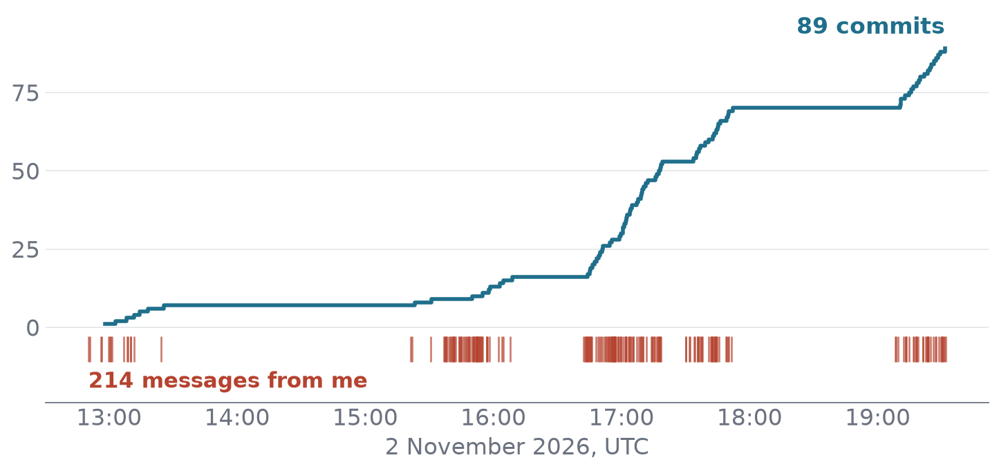

## Talk plan

:::: {.columns}
::: {.column width="68%"}
- What is infectious disease modelling?
- What are infectious disease models used for?
- What is an agent?
- Where can agents be used in infectious disease modelling?
- Challenges
- How do we collaborate when agents write the code?
- Summary
:::
::: {.column width="32%"}
{width="58%" fig-alt="QR code to the talk page"}

::: {.attribution}
[samabbott.co.uk/HPRUNetworkAgentsandIDM][talk]

Health Analytics and Modelling HPRU network.
:::
:::
::::















## Thank you

:::: {.columns}
::: {.column width="38%"}
- [How I LLM](https://samabbott.co.uk/how-I-llm)
- [A workflow for infectious disease modelling][workflow]
- [EpiNow2](https://epiforecasts.io/EpiNow2/)
- [BVDOutbreakSize report](https://epiforecasts.io/BVDOutbreakSize/dev/)
- [The prompts that built these slides][prompts]
- [A video of how they were built][video]
:::
::: {.column width="34%"}
```{=html}
<div class="people">
<div>Sam Abbott</div>
<div>Sebastian Funk</div>
</div>
<div class="agents">
<div>
seabbs-bot</div>
<div>
sbfnk-bot</div>
<div>seabbs-review-bot</div>
<div>sbfnk-review-bot</div>
</div>
```
:::
::: {.column width="28%"}
{width="80%" fig-align="center"
fig-alt="QR code to the talk page"}

::: {.attribution}
[samabbott.co.uk/HPRUNetworkAgentsandIDM][talk]

LSHTM · [epiforecasts.io](https://epiforecasts.io) ·
[github.com/seabbs](https://github.com/seabbs) ·
[github.com/sbfnk](https://github.com/sbfnk)
:::
:::
::::

## How these slides were built

:::: {.columns}
::: {.column width="40%"}
::::: {.stat-grid}
:::: {.stat .brick}
[~2 h]{.stat-num}
[of my attention, around a swim, a dog walk, a meeting and other
projects]{.stat-label}
::::
:::: {.stat .brick}
[183]{.stat-num}
[messages from me, mostly one-line steers]{.stat-label}
::::
:::: {.stat .slate}
[~800]{.stat-num}
[tool calls by one agent and four subagents]{.stat-label}
::::
:::: {.stat .teal}
[90]{.stat-num}
[commits, each one rendered and checked]{.stat-label}
::::
:::: {.stat .grey}
[~$60]{.stat-num}
[at API prices, mostly re-reading the cached context]{.stat-label}
::::
:::: {.stat .grey}
[16]{.stat-num}
[slides, against a brief of at most 13]{.stat-label}
::::
:::::
:::
::: {.column width="60%"}
{width="100%"
fig-alt="Cumulative commits through 2 November 2026, rising in bursts from
13:00 to 19:30 UTC to 90, with flat stretches. Beneath, ticks mark the 183
messages I sent, clustered in the same bursts."}

::: {.steers}
"Right, can we make the title slide a bit more fun?" ·
"Hmm, the emojis look kind of budget" · "Cut." ·
"Does the Merge and refit box still make sense?"
:::

::: {.attribution}
Claude Code with Claude Opus 5.5, one session. Counts from the session
logs and git. Every steer is on the [prompts page][prompts]. Watch the
[video][video]
:::
:::
::::

[talk]: https://samabbott.co.uk/HPRUNetworkAgentsandIDM/
[prompts]: https://samabbott.co.uk/HPRUNetworkAgentsandIDM/prompts.html
[video]: https://samabbott.co.uk/HPRUNetworkAgentsandIDM/video.html
[workflow]: https://samabbott.co.uk/a-workflow-for-infectious-disease-modelling/
[wf]: https://samabbott.co.uk/a-workflow-for-infectious-disease-modelling/
[bvd-repo]: https://github.com/epiforecasts/BVDOutbreakSize
